<div align="center">

# ◉ Radar VALLÉOR

**Radar de prospecção e CRM para quem vende sites a negócios locais.**
Encontra as empresas, mostra onde cada uma perde clientes na internet, prepara a primeira conversa e organiza a negociação até o fechamento.

> **Projeto descontinuado em novembro de 2026.**
> A VALLÉOR substituiu o Radar online por uma versão local, de uso individual, em desenvolvimento.
> **Este repositório é só a vitrine:** README e imagens. O código é privado.

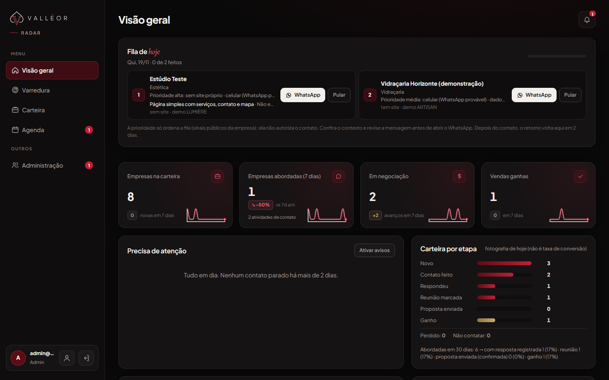

</div>

---

## O problema

Quem vende sites para pequenos negócios perde tempo descobrindo **quem** abordar e **o que** dizer. A padaria, a oficina, a clínica e o salão do bairro muitas vezes não têm site, ou têm um que não abre no celular. Mesmo assim, o primeiro contato costuma ser genérico.

O Radar VALLÉOR resolvia isso de ponta a ponta, para uma equipe de prospecção, com **custo zero de operação**: só dados abertos e planos gratuitos.

## O que ele fazia

| | |
|---|---|
| 📍 **Varredura** | Empresas por raio, cidade, estado ou Brasil inteiro, por categoria, do mais perto ao mais longe. Mais de 4 milhões de empresas na base. |
| 🔎 **Diagnóstico** | Site sem HTTPS, que não abre no celular, sem WhatsApp clicável, lento ou que é só um perfil de rede social. |
| 🏢 **Dados oficiais** | Cruzamento com os dados abertos do CNPJ da Receita Federal: atividade, data de abertura e situação. |
| 🤖 **IA com o mínimo de dados** | Resumo da oportunidade e da abordagem. A IA recebe só sinais técnicos, nunca dados pessoais. |
| 💬 **Primeiro contato** | Mensagem pronta para WhatsApp e e-mail no modelo da marca, enviada pelo Gmail do próprio vendedor, com regras de horário comercial, descadastro e limite diário. |
| 🧭 **Carteira e funil** | Etapas, histórico, agenda, retornos, alertas de contatos parados e propostas com sugestões de serviços. |
| 👥 **Equipe** | Acesso por convite e aprovação, um WhatsApp comprovado por pessoa e travas para a mesma empresa não ser abordada duas vezes. |
| ✳️ **Claude na equipe** | Cada vendedor conectava o próprio Claude ao Radar: consultar a fila, abrir a ficha, preparar rascunhos e registrar respostas, com as mesmas regras e limites da tela. |
| 🛡️ **Administração** | Pessoas e acessos, sessões por aparelho, verificação em 2 etapas e auditoria. |
| 📱 **PC e celular** | Pensado para usar na rua, no celular. |

<div align="center">

</div>

## Integrações

- **Supabase:** Postgres com Row Level Security, login e funções no servidor.
- **Cloudflare:** Pages, Functions e R2.
- **Google:** login e envio de e-mail pela API do Gmail de cada vendedor.
- **Claude (Anthropic):** conector MCP com autorização OAuth.
- **IAs gratuitas** para a análise técnica dos sites.
- **Dados abertos:** Overture Maps, Receita Federal (CNPJ), OpenStreetMap e BrasilAPI.

## Arquitetura (visão geral)

```
Navegador (PC e celular)
   │
   ▼
Cloudflare ── app estático + funções ── base pública de empresas
   │
   ├─► Supabase ── Postgres com RLS, login e funções
   ├─► Google ── login e envio pelo Gmail de cada vendedor
   └─► IAs gratuitas ── análise só de sinais técnicos

Claude de cada vendedor ──MCP + OAuth──► conector do Radar ──► mesma carteira, mesmas regras

PC, uma vez por mês: Overture Maps + Receita Federal ──► base nacional atualizada
```

Princípios que guiaram as decisões:

- **Segurança por padrão:**
  - cada empresa e cada ação ficam isoladas pela organização no próprio banco;
  - funções do servidor conferem quem pede antes de agir;
  - texto vindo de sites é tratado como não confiável.
- **Privacidade:**
  - nenhum dado de sócio pessoa física;
  - a IA não recebe nome, telefone nem texto do site;
  - quem pede para não ser contatado fica bloqueado para todos.
- **Custo zero:** a base é gerada no PC e servida como arquivos estáticos, sem API de mapas paga.

## Como foi orquestrado

Desenvolvido com IA, sob a minha orquestração:

- **Papéis definidos:**
  - o **Claude Code** implementava;
  - o **Codex** e o **Gemini** pesquisavam e revisavam;
  - **eu** decidia, validava e aprovava.
- **Etapas planejadas**, cada uma com critério de "pronto", testes e prévia no PC e no celular.
- **Banco com rede de proteção:**
  - toda mudança tinha migração, reversão e script de conferência;
  - tudo era ensaiado num Postgres local descartável antes de chegar à produção.
- **Portões de aprovação:** nenhuma mudança no banco, publicação, commit ou push acontecia sem a minha aprovação explícita, ação por ação.
- **Testes automatizados** (275 na última versão) e revisões de segurança ao longo das etapas.
- **Passagem documentada** entre sessões e contas: estado, decisões e próximo passo sempre escritos.

## Telas

> Prints da última versão, em **modo demonstração** no PC: todas as empresas, pessoas e contatos são fictícios.

| Tela | Computador | Celular |
|---|---|---|
| **Visão geral:** fila do dia, números e carteira por etapa |  | 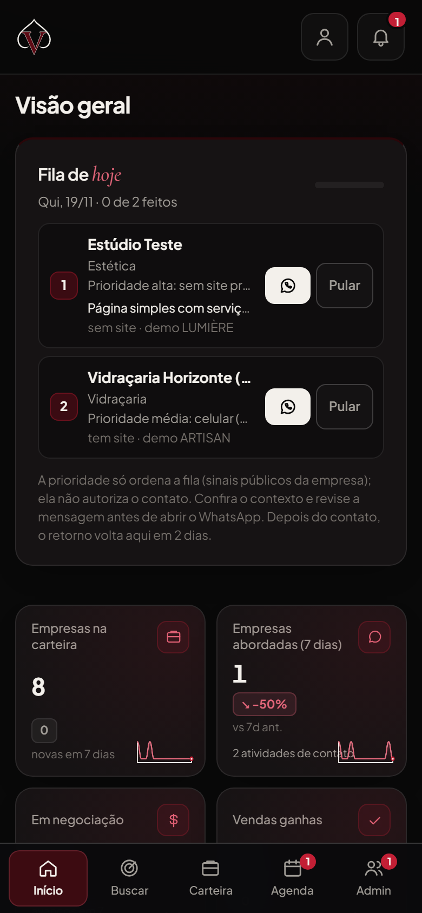 |
| **Varredura:** ramo, raio e mapa | 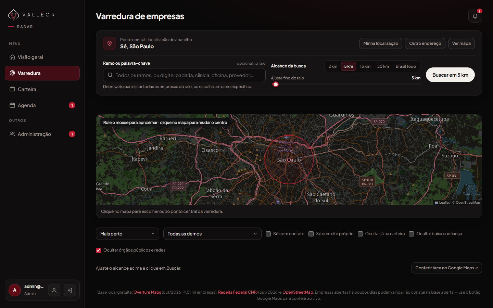 | 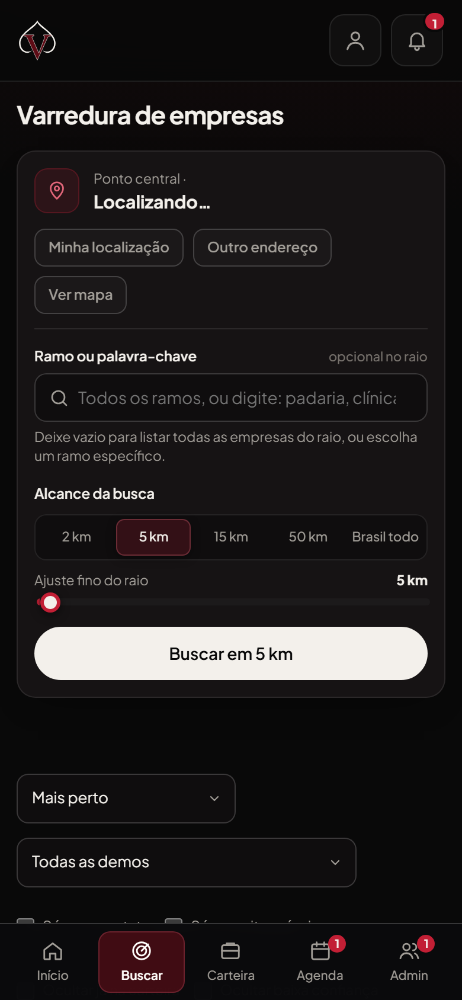 |
| **Carteira:** etapa, próxima ação e responsável | 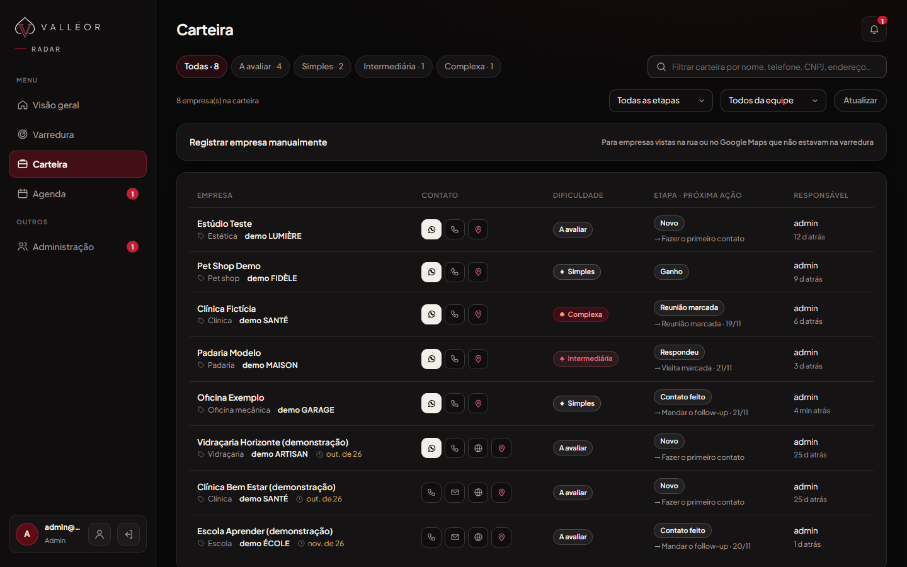 | 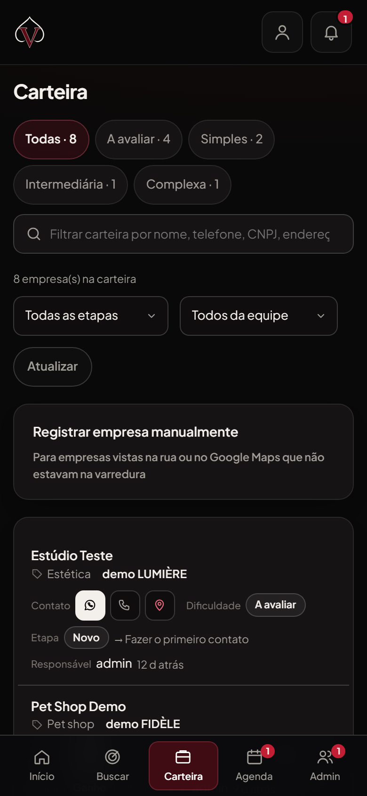 |
| **Ficha, diagnóstico:** risco, pontos observados e mensagem de abertura | 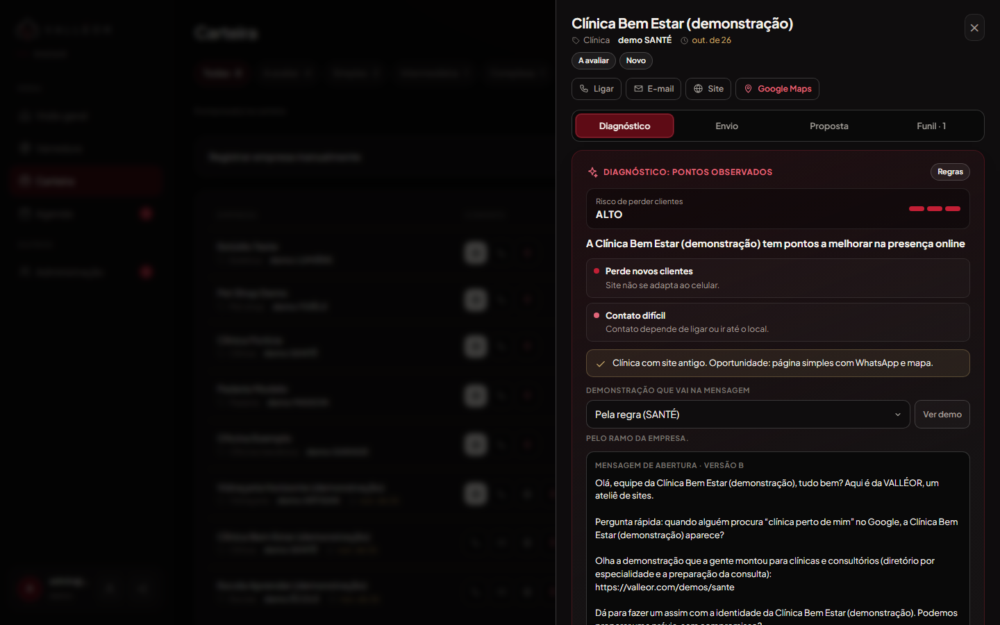 |  |
| **Ficha, envio:** por que abordar, com quem falar e canal | 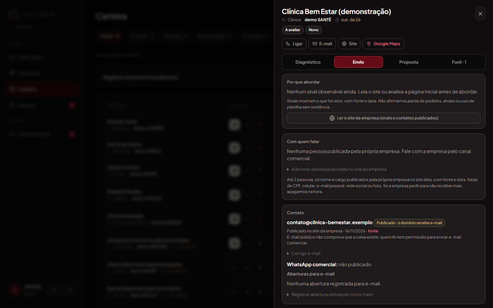 | 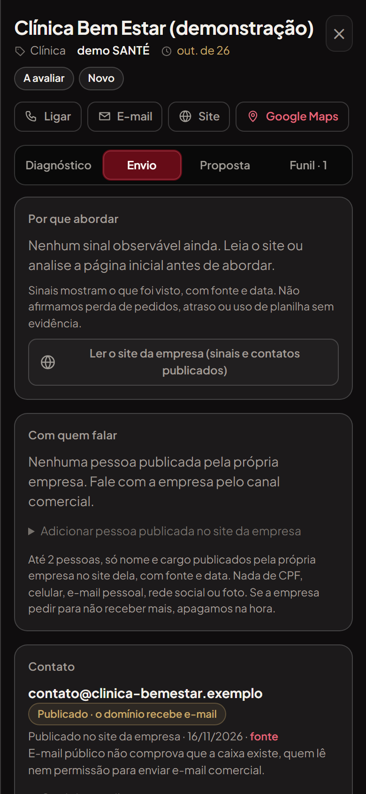 |
| **Ficha, proposta:** rascunho que o cliente vê | 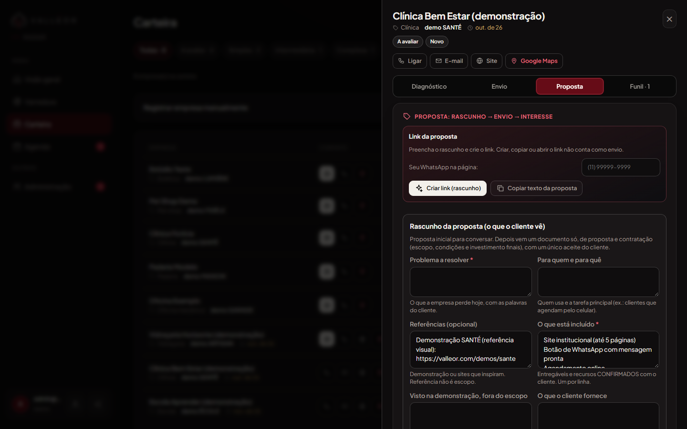 | 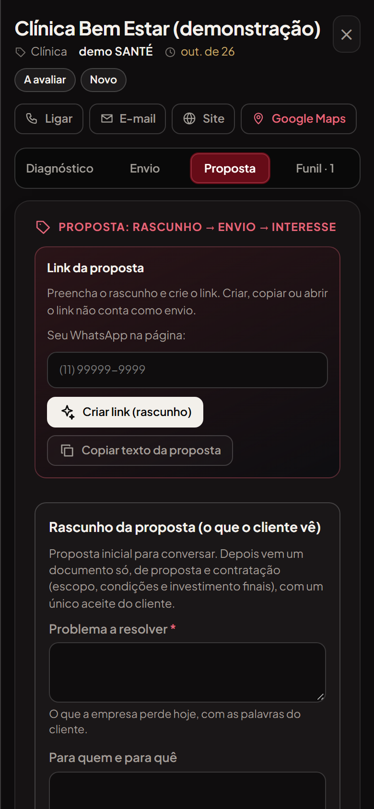 |
| **Agenda:** reuniões, visitas e retornos | 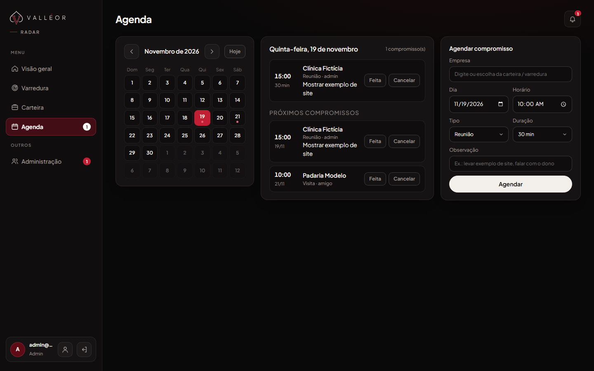 | 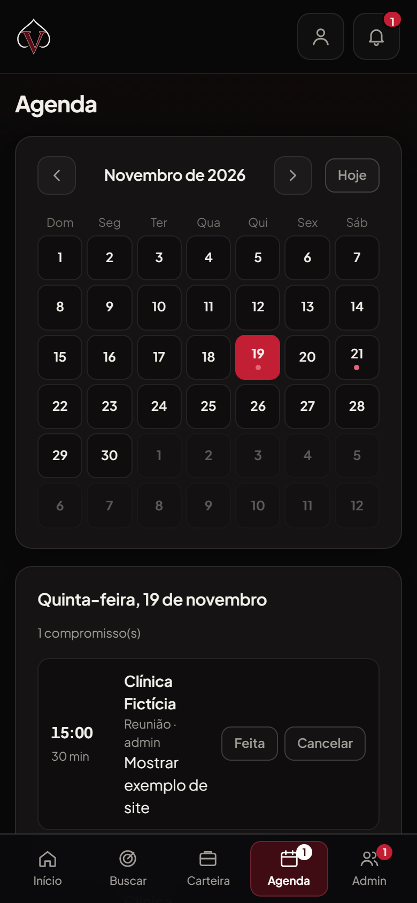 |
| **Administração:** acessos, equipe e envios | 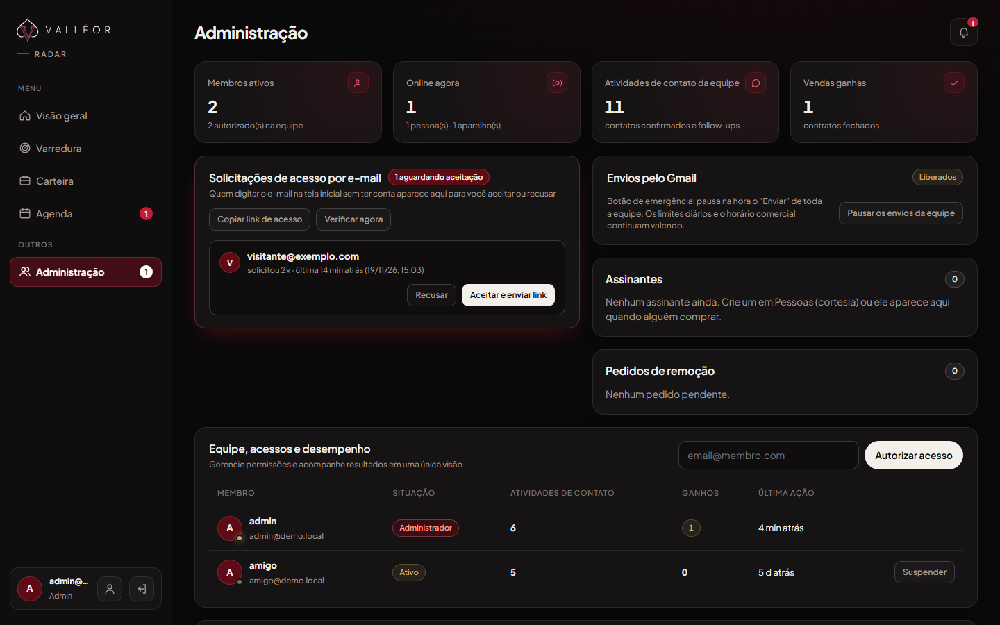 | 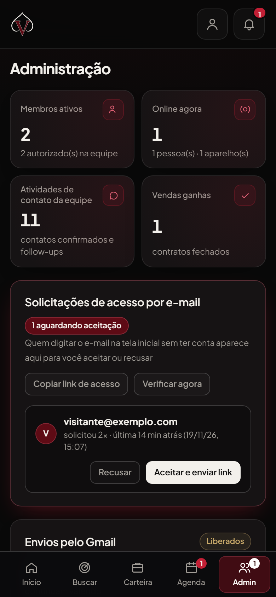 |
| **Conta:** Gmail para enviar e conector do Claude | 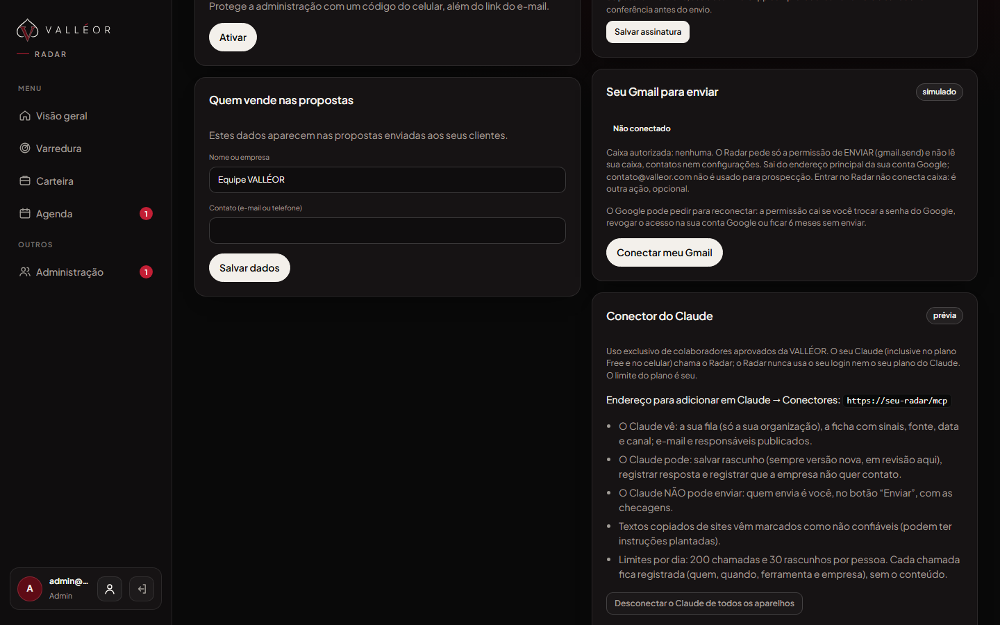 | 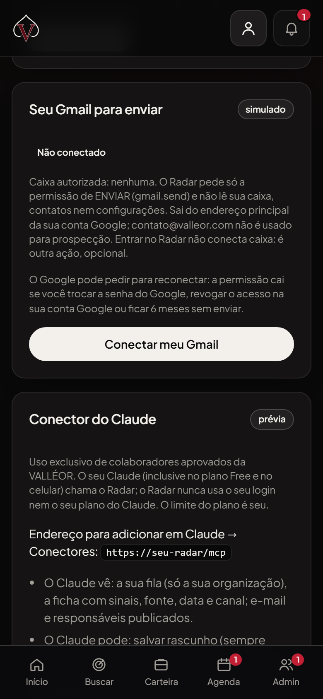 |

## Por que foi descontinuado

A arquitetura multiusuário fazia sentido para uma equipe de prospecção e para um futuro produto à venda: login, permissões, nuvem e o Claude de cada vendedor conectado.

Com a prospecção da VALLÉOR concentrada em uma pessoa, essa estrutura virou administração demais. O Radar segue em uma **versão local, de uso individual**, mais simples e mais rápida, ainda em desenvolvimento.

---

<div align="center">

Feito por **[Luan Thierry](https://www.linkedin.com/in/luan-thierry/)** · fundador da **[VALLÉOR](https://valleor.com)**

</div>
